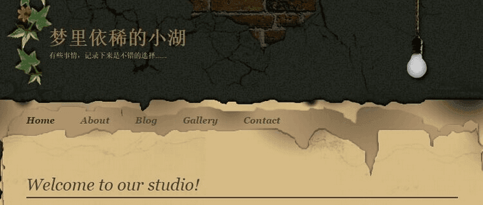

# DreamInLake

A Typecho theme built around original parchment / torn-paper artwork: light parchment + dark night dual mode, responsive on three form factors, designed for image-and-text blogs, with built-in music / video / Bilibili / photo-grid shortcodes and PJAX page transitions.

- **Live demo**: [梦里依稀的小湖 (610000.xyz)](https://610000.xyz/)
- **Requires**: Typecho 1.3
- **Tested on**: PHP 8.3 / MySQL; desktop, tablet, mobile, and the WeChat in-app browser
- **Current version**: v20261025 (2026-10-25)



> A theme first released in 2015, revived and polished with AI in 2026. Free and open source (MIT) — issues, improvements and pull requests are warmly welcome.

## What's new in v20261025

- Tag page: a rotating 3D tag sphere (drag / hover, reduced-motion aware, flat-list fallback when JavaScript is off), with random-read cards below it.
- Search: a dedicated landing page linked from the nav; results are rendered server-side as homepage-style cards. No result-count line; an empty search shows random reads instead of an error message.
- List cards: home, search and archive lists share one card style — badge + title + two-line excerpt, the whole card clickable, thumbnail on the right (stacked on mobile).
- Sticky posts: set the custom field `sticky=1` to pin a post to the top of the homepage's first page (with a 置顶 badge); it never repeats elsewhere in the list.
- Previous / next navigation now works even for posts published in the same second.
- 404 pages redirect (302) to the search page instead of showing a dead end.
- Mobile: the menu no longer spills off the torn-paper zone; card thumbnails are vertically centered.
- Artwork ships as WebP; homepage thumbnails, gallery grids and the lightbox use sized variants; CSS/JS pair with long server caching.
- New theme settings: show / hide the 归档 / 标签 nav links, and an auto-tag switch (on by default) that suggests up to 5 tags for a new post.

**中文说明见下方 [中文版](#中文版)。**

## Features

### Visuals & responsive layout
- Original artwork throughout: brick-wall header, parchment body, torn-paper edges, footer — five theme images form one visual set.
- Three form factors: desktop (content centered, max 1180px), tablet, and mobile (≤640px single column; the paper is scaled up so its transparent edges crop away and text sits directly on the paper).
- Date badges: every post carries a round, stamp-like date badge in 6 rotating colors.

### Dark mode (the light-bulb switch)
- The hanging bulb in the header is the switch: **bulb on = dark, bulb off = light**. The state is always visible, with no hover effects; the click target hugs the bulb itself (positioned by in-image coordinates), so clicking the cord or the surrounding area does nothing.
- Follows the system by default: the first visit uses `prefers-color-scheme`; once you toggle manually, your choice is remembered (localStorage) and system changes no longer override it; without a manual choice it keeps following the system live.
- How dark mode is drawn: a deep-brown overlay on the paper artwork (torn-paper texture preserved), warm beige text, bright gold links; **photos in posts are never recolored**.
- No flash of the wrong theme: the mode is decided before first render; `color-scheme: light dark` is declared so Android browsers don't apply their own algorithmic darkening.

### Reading experience
- **PJAX navigation**: in-site links swap the content with a fade — title, address bar and back/forward stay in sync; any playing audio/video stops on navigation.
- **Lightbox**: post images and grid photos open full-screen, grouped per post (or per grid), with a counter (e.g. 3 / 9); swipe on mobile, round buttons plus ← / → / Esc keys on desktop; adjacent images are preloaded.
- Pagination in a parchment "pill" style, shared by post lists, archives and comments (comment pagination fully works).
- Previous / next post navigation; over-long titles collapse to one line with an ellipsis, full title on hover.

### Media shortcodes (no plugin needed)
- Music: `[Music title="Title" author="Artist" url="audio URL" pic="cover" lrc="lyrics"/]` (APlayer; `pic` and `lrc` optional)
- Video: `[Video url="video URL" pic="cover"/]` (ArtPlayer; if the player library ever fails to load it falls back to the browser's native player — never a black box)
- Multi-episode video: one URL per line between `[play]` and `[/play]`
- Bilibili: `[bilibili bvid="BVxxxx"/]` (click-to-play embed; see the Worker section below)
- Photo grid: one image URL per line between `[gallery]` and `[/gallery]` — laid out as a 3×3 grid and wired into the lightbox

### Performance
- Player libraries load on demand: a text-only page skips ~216KB of player code.
- CSS/JS URLs carry version parameters for cache busting; static assets pair well with long server-side caching (images/media 30 days, CSS/JS 7 days).

### Search & comments
- Search has its own landing page (linked from the nav); results are rendered server-side as list cards; the input uses 16px type so iOS doesn't auto-zoom on focus.
- The comment form blends transparently into the paper in both modes, and its submit button follows the theme colors.

## Installation

1. Download this repository as a zip (or grab the ready-made theme package from the [intro post on the demo site](https://610000.xyz/archives/1/)).
2. Unzip, rename the folder to `dreaminlake`, and put it under Typecho's `usr/themes/`.
3. In the admin panel → Appearance, activate DreamInLake.
4. Optional: under Appearance settings, fill in a site LOGO URL, tick the sidebar blocks, and set your Bilibili Worker URL (next section).

## File Structure

```text
dreaminlake/
├── index.php        # Home / list template
├── post.php         # Post template
├── page.php         # Page template
├── archive.php      # Category / tag / search / author archives
├── tpl_archive.php  # Archives page template
├── tpl_tags.php     # Tags page template
├── tpl_search.php   # Search page template
├── search.php       # Search results template
├── search-form.php  # Search form partial
├── post-block.php   # Shared list card (home / search / archives)
├── random-cards.php # Random-post cards partial
├── comments.php     # Comments template
├── header.php       # Header
├── footer.php       # Footer
├── sidebar.php      # Sidebar
├── post-date.php    # Date-stamp component
├── 404.php          # 404 template
├── functions.php    # Theme settings & helpers
├── media.php        # Shortcode parser (music / video / bilibili / gallery)
├── media.js         # Frontend script (PJAX / lightbox / players)
├── style.css        # Stylesheet
├── assets/          # Player libraries (APlayer / ArtPlayer, lazy-loaded)
├── images/          # Theme artwork (brick wall / parchment / bulb, etc.)
├── screenshot.png   # Theme screenshot
├── README.md        # This document
└── LICENSE          # MIT License
```

## Bilibili playback: bring your own Worker

The `[bilibili]` shortcode plays videos through a tiny proxy page hosted on **your own Cloudflare Worker**. Reason: Bilibili's official embed is often blocked or forced into the app inside WeChat / iOS in-app browsers, while a same-purpose page served from your own domain plays inline reliably.

**Setup**

1. Create a Cloudflare Worker (Cloudflare dashboard → Workers & Pages → Create → Worker) and paste in code equivalent to the example below. The contract is simple: `GET {your-prefix}{bvid}` returns a playable embed page.
2. Copy your Worker URL prefix, e.g. `https://your-name.workers.dev/video/`.
3. In Typecho admin → Appearance → theme settings → **Bilibili Worker URL**, paste the prefix. Done — the theme appends each BV id to it.

**If you leave it empty**, the shortcode falls back to Bilibili's official player iframe (`player.bilibili.com`). That works in regular browsers, but may be restricted in WeChat / iOS webviews.

Minimal example Worker (returns an embed page for `/video/<bvid>`):

```js
export default {
  async fetch(request) {
    const url = new URL(request.url);
    const bvid = url.pathname.split('/').filter(Boolean).pop() || '';
    if (!/^BV[0-9A-Za-z]+$/.test(bvid)) {
      return new Response('Not Found', { status: 404 });
    }
    const html = '<!doctype html><html><head><meta charset="utf-8">'
      + '<meta name="viewport" content="width=device-width,initial-scale=1">'
      + '<meta name="referrer" content="no-referrer">'
      + '<style>html,body{margin:0;height:100%;background:#000}iframe{width:100%;height:100%;border:0}</style>'
      + '</head><body><iframe src="https://player.bilibili.com/player.html?bvid=' + bvid
      + '&page=1&high_quality=1&danmaku=0&autoplay=1" allowfullscreen '
      + 'allow="autoplay; fullscreen; picture-in-picture"></iframe></body></html>';
    return new Response(html, { headers: { 'content-type': 'text/html; charset=utf-8' } });
  }
};
```

## Notes

1. **Bump the version parameter when you edit CSS/JS**: after changing `style.css`, update the `style.css?v=` value in `header.php`; after `media.js`, the one in `footer.php`. Otherwise browsers (WeChat especially) keep serving the old cached files and your change looks like a no-op.
2. **Don't stack browser night mode on top**: if the browser's own "dark web / night mode" is on, it darkens the page a second time and the background goes nearly black. Use one or the other — when using the bulb's dark mode, turn the browser feature off (or whitelist the site).
3. **Never lazy-load grid images**: the theme handles iOS Safari compatibility itself (its native lazy loading randomly drops images); don't add `loading="lazy"` to `[gallery]` images.
4. **The bulb image and its click area are a pair**: the click target is positioned for the current bulb artwork (glass bulb at x153–188, y67–125 inside the image). If you replace the bulb art, adjust `#bulbHit` in `style.css` to match.
5. **Stagger publish times when bulk-importing posts**: Typecho's previous/next navigation sorts strictly by publish time; posts published in the same second can't "see" each other. Offsetting each post by a few seconds fixes it.
6. **When writing posts directly into the database**, the content must start with a `<!--markdown-->` marker, or Markdown won't be parsed (shortcodes still work, which makes this easy to misdiagnose).
7. Don't ship backup files (`.bak`, `.prelou`, etc.) inside the theme folder when packaging a release — they may leak sensitive configuration.

## Contributing

Issues and pull requests are welcome — bug fixes, compatibility work, new features. This theme is largely a labor of love; company in polishing it is appreciated.

## Author & license

- Author: 梦里依稀的小湖 — https://610000.xyz/
- Original author of every release since the theme's first publication in 2015.
- License: [MIT](LICENSE) — free to use, modify and redistribute; keep the copyright and license notices.

---

# 中文版

一款基于原创羊皮纸撕纸美术的 Typecho 主题：浅色羊皮纸 + 深色夜间双模式，三端响应式，为图文博客设计，内置音乐、视频、B站、九宫格短代码与无刷新翻页。

- **演示站**：[梦里依稀的小湖](https://610000.xyz/)
- **适用**：Typecho 1.3
- **实测环境**：PHP 8.3 / MySQL，PC、平板、手机、微信内置浏览器
- **当前版本**：v20261025（2026-10-25）

> 这是一款 2015 年的老主题，2026 年利用 AI 重新打磨升级。免费开源（MIT），欢迎使用，也欢迎一起完善和拓展它。

## v20261025 更新内容

- 标签页：可旋转的 3D 标签球（可拖动 / 悬停、支持减动效、无 JS 时回退为平铺列表），下方附「随便读读」卡片。
- 搜索：导航栏「搜索」进入独立落地页，结果由服务端渲染为首页风格卡片；不显示结果计数，空搜索时显示随机文章而非报错文案。
- 列表卡片：首页、搜索、归档列表共用一套卡片样式——徽标 + 标题 + 两行摘要，整卡可点，缩略图在右（移动端上下排布）。
- 置顶文章：给文章加自定义字段 `sticky=1`，即可置顶到首页第一页首位（带「置顶」牌子），且不会在列表其他位置重复出现。
- 上一篇 / 下一篇导航：同一秒发布的文章也能互相找到。
- 404 页面改为 302 跳转到搜索页，不再是死胡同。
- 移动端：菜单不再溢出撕纸区域；卡片缩略图垂直居中。
- 主题图改为 WebP；首页缩略图、九宫格、灯箱大图分别用对应尺寸；CSS / JS 配合服务器长缓存。
- 新增主题设置：归档 / 标签导航链接的显示开关，以及自动标签开关（默认开启），为新文章推荐最多 5 个标签。

## 功能特性

### 视觉与响应式
- 原创美术：页头砖墙、羊皮纸正文、撕纸边缘、页脚，五张主题图构成整套视觉。
- 三端自适应：PC（最大 1180px 居中）、平板、手机（≤640px 单列 + 纸面放大挤出透明边，文字贴纸面排版）。
- 日期章：每篇文章带彩色圆形日期章（6 种色调轮换）。

### 深色模式（灯泡切换）
- 顶部灯泡即开关：**灯亮 = 深色，灯灭 = 浅色**，状态常显、无悬停效果；点击区紧贴灯泡本体（按图内坐标定位），点吊线和周围不触发。
- 默认跟随系统：首次访问按 `prefers-color-scheme` 自动选择；手动点过后记住选择（localStorage），系统变化不再覆盖；无手动选择时实时跟随系统切换。
- 深色画法：纸面美术图叠深棕罩，撕纸纹理保留；文字转暖米色、链接亮金；文章照片一律不动色。
- 防闪烁：主题在页面渲染前判定，打开即目标颜色；声明 `color-scheme: light dark` 双模式，安卓浏览器不会再算法乱变暗。

### 阅读体验
- **PJAX 无刷新翻页**：站内链接点击即换正文（淡入淡出），标题、地址栏、前进/后退同步；切页自动停止正在播放的音视频。
- **灯箱**：正文图片与九宫格点击看大图，同一文章/同一九宫格内的图片自动成组；底部计数（如 3 / 9）；移动端手指滑动翻页（对齐微信体验），PC 端有圆按钮与键盘 ←/→/Esc；相邻图片预加载。
- 分页：羊皮纸药丸样式，文章列表、归档、评论区共用；评论区分页完整可用。
- 上一篇/下一篇导航齐全；标题过长自动单行省略，悬停可看全文。

### 媒体短代码（写文章时直接用）
- 音乐：`[Music title="歌名" author="歌手" url="音频地址" pic="封面" lrc="歌词"/]`（APlayer，lrc、pic 可省略）
- 视频：`[Video url="视频地址" pic="封面"/]`（ArtPlayer 内嵌播放；播放器万一加载失败会自动回退为浏览器原生播放器，不会黑屏）
- 视频分集：`[play]` 与 `[/play]` 之间一行放一个视频地址
- B站：`[bilibili bvid="BVxxxx"/]`（点击后内嵌播放；需要自备 Worker，见下节）
- 九宫格：`[gallery]` 与 `[/gallery]` 之间一行放一个图片地址，自动排成 3×3 并接入灯箱

### 性能
- 播放器库按需加载：页面上有音乐/视频元素时才拉取对应库，纯文字页省约 216KB。
- CSS/JS 带版本参数，更新自动破缓存；静态资源可配合服务器长缓存（图片/音视频 30 天、CSS/JS 7 天）。

### 搜索与评论
- 搜索有独立落地页（导航栏「搜索」进入），结果由服务端渲染为列表卡片；移动端输入字号 16px，iOS 聚焦不会自动放大页面。
- 评论表单透明融入纸面，深浅色均适配；提交按钮随主题变色。

## 安装

1. 下载本仓库的 zip（或从[演示站的主题介绍文章](https://610000.xyz/archives/1/)下载打包好的主题包）；
2. 解压后把文件夹改名为 `dreaminlake`，放到 Typecho 的 `usr/themes/` 目录下；
3. 后台 → 外观，启用 DreamInLake；
4. （可选）在「设置外观」里填写站点 LOGO 地址、勾选侧边栏模块、填写你的 B站 Worker 地址（见下节）。

## 文件结构

```text
dreaminlake/
├── index.php        # 首页 / 列表模板
├── post.php         # 文章页模板
├── page.php         # 独立页模板
├── archive.php      # 分类 / 标签 / 搜索 / 作者归档
├── tpl_archive.php  # 归档页模板
├── tpl_tags.php     # 标签页模板
├── tpl_search.php   # 搜索页模板
├── search.php       # 搜索结果模板
├── search-form.php  # 搜索表单部件
├── post-block.php   # 通用列表卡片（首页 / 搜索 / 归档）
├── random-cards.php # 随机文章卡片部件
├── comments.php     # 评论模板
├── header.php       # 页头
├── footer.php       # 页脚
├── sidebar.php      # 侧边栏
├── post-date.php    # 日期章部件
├── 404.php          # 404 页模板
├── functions.php    # 主题设置与工具函数
├── media.php        # 短代码解析（音乐 / 视频 / B站 / 九宫格）
├── media.js         # 前台脚本（PJAX / 灯箱 / 播放器）
├── style.css        # 样式表
├── assets/          # 播放器库（APlayer / ArtPlayer，按需加载）
├── images/          # 主题美术图（砖墙 / 羊皮纸 / 灯泡等）
├── screenshot.png   # 主题截图
├── README.md        # 项目说明文档
└── LICENSE          # 开源许可证（MIT）
```

## B站播放：需要自备 Worker

`[bilibili]` 短代码通过一个部署在**你自己的 Cloudflare Worker** 上的小代理页播放。原因是 B 站官方嵌入在微信 / iOS 内置浏览器里经常被拦截或强制跳 App，而由你自己域名提供的同用途页面可以稳定内嵌播放。

**配置步骤**

1. 新建一个 Cloudflare Worker（Cloudflare 控制台 → Workers & Pages → 创建 → Worker），粘贴与下方示例等价的代码。约定很简单：`GET {你的地址前缀}{BV号}` 返回一个可播放的嵌入页即可。
2. 记下你的 Worker 地址前缀，例如 `https://your-name.workers.dev/video/`。
3. Typecho 后台 → 外观 → 设置外观 → **B站播放 Worker 地址**，把前缀粘进去即可，主题会自动把每个 BV 号拼在其后。

**留空会怎样**：短代码回退为 B 站官方播放器直嵌（`player.bilibili.com`），普通浏览器可以正常播放，但在微信 / iOS 内置浏览器里可能受限。

最小示例 Worker（为 `/video/<bvid>` 返回嵌入页）：

```js
export default {
  async fetch(request) {
    const url = new URL(request.url);
    const bvid = url.pathname.split('/').filter(Boolean).pop() || '';
    if (!/^BV[0-9A-Za-z]+$/.test(bvid)) {
      return new Response('Not Found', { status: 404 });
    }
    const html = '<!doctype html><html><head><meta charset="utf-8">'
      + '<meta name="viewport" content="width=device-width,initial-scale=1">'
      + '<meta name="referrer" content="no-referrer">'
      + '<style>html,body{margin:0;height:100%;background:#000}iframe{width:100%;height:100%;border:0}</style>'
      + '</head><body><iframe src="https://player.bilibili.com/player.html?bvid=' + bvid
      + '&page=1&high_quality=1&danmaku=0&autoplay=1" allowfullscreen '
      + 'allow="autoplay; fullscreen; picture-in-picture"></iframe></body></html>';
    return new Response(html, { headers: { 'content-type': 'text/html; charset=utf-8' } });
  }
};
```

## 注意事项

1. **改样式必须升版本号**：修改 `style.css` 后，务必同步修改 `header.php` 里 `style.css?v=` 的参数；修改 `media.js` 后同步改 `footer.php` 里的 `?v=`。否则浏览器（尤其微信）会长期读旧缓存，改了像没改。
2. **深色不要叠浏览器夜间模式**：若浏览器开了自带"网页深色/夜间模式"，它会在本站深色之上再盖一层，背景会接近全黑。二选一：用灯泡深色时，关掉浏览器的网页深色（或把本站加白名单）。
3. **九宫格图片不要加懒加载**：主题已按 iOS Safari 的兼容性处理（该浏览器原生懒加载会随机丢图），自行改图时勿给九宫格图片加 `loading="lazy"`。
4. **灯泡图与点击区是配套的**：点击区坐标按现有灯泡图（玻璃泡在图内 x153–188、y67–125）定位；若更换灯泡美术图，需同步调整 `style.css` 中 `#bulbHit` 的位置与尺寸。
5. **批量导入文章时错开发布时间**：Typecho 的上一篇/下一篇按发布时间严格排序，同一秒发布的文章会互相"看不见"，导入时把时间逐篇错开即可。
6. **直接写数据库发文章**时，正文开头要加 `<!--markdown-->` 标记，否则 Markdown 不解析（短代码仍生效，容易误判）。
7. 主题目录内不要留 `.bak`、`.prelou` 等备份文件再打包发布，避免混入敏感配置。

## 参与贡献

欢迎提交 Issue 和 Pull Request：修 bug、补兼容、加功能都行。这更多是一份情怀作品，能有人一起打磨它会很开心。

## 作者与许可

- 作者：梦里依稀的小湖 — https://610000.xyz/
- 本主题自 2015 年最初发布至今，历次版本均为同一作者原创与维护。
- 许可证：[MIT License](LICENSE) — 可自由使用、修改与分发，保留版权与许可声明即可。
